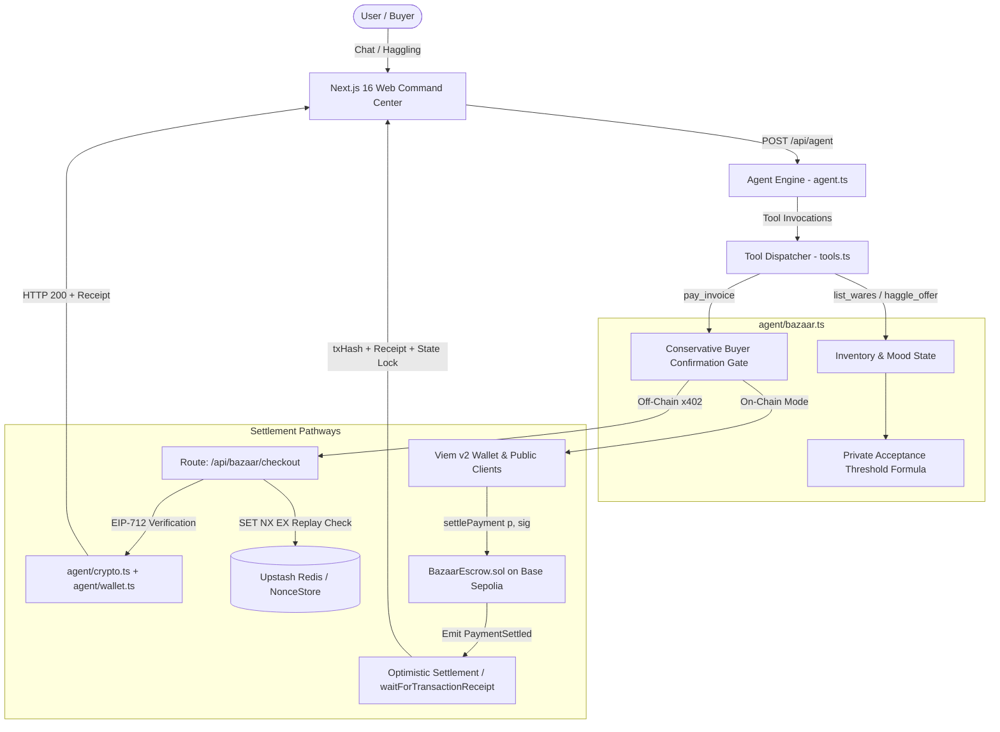
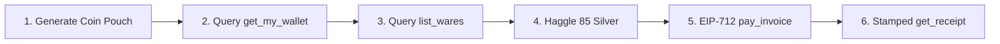

<div align="center">


# Marzban: The Agentic Bazaar Merchant

**Autonomous Street-Market Merchant Agent with Multi-Round Negotiation, EIP-712 Cryptographic Gating, and Base Sepolia On-Chain Escrow Settlement**

[](https://nextjs.org/)
[](https://react.dev/)
[](https://www.typescriptlang.org/)
[](https://www.npmjs.com/package/@google/genai)
[](https://viem.sh/)
[-363636?style=flat-square&logo=solidity)](https://soliditylang.org/)
[-0052FF?style=flat-square&logo=coinbase)](https://sepolia.basescan.org/)
[](https://nodejs.org/api/test.html)
[](./CONTRIBUTING.md)
[](./LICENSE)

> *"Welcome, traveler, to the Grand Bazaar of Nishapur! I am Marzban—purveyor of celestial relics, guardian of confidential reserve floors, and humble servant of honest silver. Inquire of the stars, haggle for the legendary Brass Astrolabe, or test your wit against my stall. But heed this counsel: insult my wares with a pittance, and you shall taste an unyielding counter-offer!"*

<br>

### 🎬 Video Demonstrations

#### 📹 Demo 01: Theatrical Bazaar Walkthrough & Multi-Round Negotiation (`marzban_demo01.webm`)

<video width="100%" max-width="840px" controls preload="metadata" poster="https://img.shields.io/badge/▶_PLAY_DEMO_01-Marzban_Bazaar_Walkthrough-D3F65A?style=for-the-badge&logo=googleplay&logoColor=10110F&labelColor=171915">
  <source src="https://drive.google.com/uc?export=download&id=1Z3U4EBHxnbjpEluNluP2tZgWw0jQn_AF" type="video/webm">
  Your browser does not support the video tag.
</video>

<p align="center">
  <a href="https://drive.google.com/file/d/1Z3U4EBHxnbjpEluNluP2tZgWw0jQn_AF/preview" target="_blank" rel="noopener noreferrer">
    
  </a>
  <a href="https://drive.google.com/file/d/1Z3U4EBHxnbjpEluNluP2tZgWw0jQn_AF/view?usp=sharing" target="_blank" rel="noopener noreferrer">
    
  </a>
  <a href="https://drive.google.com/uc?export=download&id=1Z3U4EBHxnbjpEluNluP2tZgWw0jQn_AF" target="_blank" rel="noopener noreferrer">
    
  </a>
</p>

<br>

#### 📹 Demo 02: End-to-End Autonomous Crypto & Browser Tool Execution (`marzban_demo02.mp4`)

<video width="100%" max-width="840px" controls preload="metadata" poster="https://img.shields.io/badge/▶_PLAY_DEMO_02-Autonomous_Crypto_&_Tool_Calling-6366F1?style=for-the-badge&logo=googleplay&logoColor=white&labelColor=171915">
  <source src="https://drive.google.com/uc?export=download&id=1JGINOwl82ZkrktQPI_XH0wXvoc8DQb_P" type="video/mp4">
  Your browser does not support the video tag.
</video>

<p align="center">
  <a href="https://drive.google.com/file/d/1JGINOwl82ZkrktQPI_XH0wXvoc8DQb_P/preview" target="_blank" rel="noopener noreferrer">
    
  </a>
  <a href="https://drive.google.com/file/d/1JGINOwl82ZkrktQPI_XH0wXvoc8DQb_P/view?usp=sharing" target="_blank" rel="noopener noreferrer">
    
  </a>
  <a href="https://drive.google.com/uc?export=download&id=1JGINOwl82ZkrktQPI_XH0wXvoc8DQb_P" target="_blank" rel="noopener noreferrer">
    
  </a>
</p>

</div>

---

## 📑 Table of Contents

- [🏛️ Project Description & Architecture](#️-project-description--architecture)
- [🎯 What Problem This Solves](#-what-problem-this-solves)
- [⚡ Tech Stack & Verified Versions](#-tech-stack--verified-versions)
- [🛠️ Capabilities & The 9-Tool Matrix](#️-capabilities--the-9-tool-matrix)
- [🧠 AI Model Configuration & Switching](#-ai-model-configuration--switching)
- [🛡️ Serverless Zero-504 Timeout Architecture](#️-serverless-zero-504-timeout-architecture)
- [🤖 E2E Browser Automation & Verification Suite](#-e2e-browser-automation--verification-suite)
- [🚀 Environment Setup & Local Development](#-environment-setup--local-development)
  - [1. Clone & Install Dependencies](#1-clone--install-dependencies)
  - [2. Configure Environment Variables](#2-configure-environment-variables)
  - [3. Compile & Deploy Escrow Smart Contract](#3-compile--deploy-escrow-smart-contract)
  - [4. Run Local Development Server](#4-run-local-development-server)
  - [5. Run Automated Verification Suite](#5-run-automated-verification-suite)
- [🧰 The Troubleshooting Matrix](#-the-troubleshooting-matrix)
  - [1. Cryptographic & EVM Settlement Errors](#1-cryptographic--evm-settlement-errors)
  - [2. Distributed Replay Protection Blocks](#2-distributed-replay-protection-blocks)
  - [3. Wallet Filesystem & Serverless EROFS Errors](#3-wallet-filesystem--serverless-erofs-errors)
  - [4. Agent & LLM Provider Operational Errors](#4-agent--llm-provider-operational-errors)
- [🎨 Marzban Bazaar UI/UX Transformation](#-marzban-bazaar-uiux-transformation)
- [📊 Observability & Telemetry Architecture](#-observability--telemetry-architecture)
- [📜 License](#-license)

---

## 🏛️ Project Description & Architecture

**Marzban** is an autonomous, full-stack AI merchant application built on **Next.js 16 (App Router)**, the **Google Gen AI SDK** (`@google/genai`), and **Viem v2**. Operating within a theatrical Persian marketplace narrative, Marzban manages an interactive bazaar stall with deterministic inventory, dynamic mood shifts, confidential floor defense, and programmatic Web3 checkout settlement.

### System Architecture Diagram



### Core Architectural Pillars

1. **Deterministic Inventory & Negotiation State Machine (`agent/bazaar.ts`)**:
   - Manages 6 distinct cataloged wares: *Brass Astrolabe*, *Saffron Tin*, *Silk Scarf*, *Haunted Oil Lamp*, *Seven-Spice Box*, and *Treasure Map Scroll*.
   - Implements bounded 4-round negotiations per item.
   - Enforces dynamic merchant moods (`cheerful`, `neutral`, `grumpy`) driven by insult triggers (offers `< 70%` of private cost).
2. **Mathematical Reserve Floor Defense**:
   - Calculates dynamic acceptance thresholds: $\text{threshold} = \min(\text{basePrice}, \lceil \text{privateCost} \times 1.15 \times \text{moodFactor} \rceil)$.
   - Guarantees zero margin leakage: counter-offers always remain strictly above the private threshold and never increase from the asking price.
3. **Conservative Buyer Confirmation Gate**:
   - Multi-layer authorization gate requiring explicit buyer consent in the active turn.
   - Disambiguates multi-deal conversations, validates mentioned prices, and detects hesitancy, questions, or dissents before any payment tool executes.
4. **Dual Settlement Protocol (Off-Chain x402 & On-Chain Escrow)**:
   - **Off-Chain**: HTTP 402 challenge/response using EIP-712 typed structured data signing (`Payment(address from,address to,string amount,string asset,string resource,string nonce,uint256 deadline)`), validated by atomic distributed nonce tracking (`SET NX EX`).
   - **On-Chain**: Solidity escrow smart contract (`contracts/BazaarEscrow.sol`) deployed to **Base Sepolia (Chain ID: 84532)** verifying signatures, preventing replay attacks via `consumedNonces`, transferring native ETH, and emitting verifiable on-chain event logs.

---

## 🎯 What Problem This Solves

| Problem | Traditional Agent Vulnerability | Marzban's Hardened Solution |
| :--- | :--- | :--- |
| **Margin Leakage & Price Hallucination** | LLMs easily get persuaded by users to sell items at a loss or hallucinate discounts. | **Deterministic State Machine**: Prices and floors are calculated in pure TypeScript. Private costs are strictly omitted from prompts and tools; the LLM cannot reveal what it never receives. |
| **Unauthorized Autonomous Spending** | Agents initiate financial transfers based on ambiguous user prompts (e.g., *"What would it cost?"*). | **Conservative Confirmation Gate**: Requires affirmative intent in the active conversation turn, filters out dissents/questions, checks deal IDs, and validates agreed prices before checkout unlocks. |
| **Payment Replay & Signature Theft** | EIP-191 message signatures can be intercepted and replayed repeatedly to drain merchant inventory or trigger duplicate orders. | **EIP-712 + Atomic Nonce Locks**: All authorizations are domain-separated (Chain ID 84532) with a 5-minute deadline and single-use cryptographic UUID nonces guarded by Upstash Redis `SET NX EX` and on-chain nonce registries. |
| **Serverless EVM Wallet Crashes** | Next.js serverless runtimes (e.g., Vercel AWS Lambda) enforce a read-only filesystem (`EROFS`), crashing agents trying to persist `.agent-wallet.json`. | **Multi-Tiered Ephemeral Storage**: Seamlessly loads `WALLET_PRIVATE_KEY` from env, with fallbacks to `os.tmpdir()` and in-memory key stores, preventing serverless crashes. |
| **Serverless 504 Timeouts** | Blocking EVM block finality and multi-step ReAct loops exceed the 10s/15s proxy limit. | **Circuit Breakers & Optimistic Settlement**: ReAct loop capped with 45s hard circuit breaker, 4s fetch timeouts with AbortSignals, and non-blocking background receipt settlement. |

---

## ⚡ Tech Stack & Verified Versions

All dependencies have been statically audited from `package.json` and verified for Node.js 20+ compatibility:

- **Framework**: [Next.js](https://nextjs.org/) `16.4.3` (App Router) with Webpack build optimization.
- **UI & React Runtime**: [React](https://react.dev/) `^19.3.0` & `react-dom` `^19.3.0`.
- **Language**: [TypeScript](https://www.typescriptlang.org/) `^5.9.3` with strict type checking (`tsc --noEmit`).
- **AI / LLM SDK**: [@google/genai](https://www.npmjs.com/package/@google/genai) `^2.24.0` (Google Gen AI SDK for Gemini).
- **Web3 & Cryptography**: [Viem](https://viem.sh/) `^2.56.9` for EIP-712 typed signing, public/wallet clients, and event log parsing.
- **Smart Contracts**: [@openzeppelin/contracts](https://www.openzeppelin.com/contracts) `^5.2.0` (`EIP712`, `ECDSA`, `ReentrancyGuard`).
- **Smart Contract Tooling**: [Hardhat](https://hardhat.org/) `^3.0.0` with Cancun EVM target and solc `0.8.24`.
- **Styling**: [Tailwind CSS](https://tailwindcss.com/) `^4.3.3` with `@tailwindcss/postcss` `^4.3.3` and `tw-animate-css` `^1.4.0`.
- **Icons & Primitives**: [Lucide React](https://lucide.dev/) `^1.48.0` & [@base-ui/react](https://base-ui.com/) `^1.8.0`.
- **3D Graphics & Canvas**: [Three.js](https://threejs.org/) `^0.186.1` & [@react-three/fiber](https://r3f.docs.pmnd.rs/) `^9.8.2`.
- **Test Harness**: Node.js Native Test Runner with [Jiti](https://github.com/unjs/jiti) `^2.4.2` TypeScript compilation (**86/86 Passing**).

---

## 🛠️ Capabilities & The 9-Tool Matrix

Marzban possesses 9 deterministic tools registered in [`my-agent/agent/tools.ts`](file:///c:/Users/Dell/OneDrive/Desktop/Project/agentmaxx/my-agent/agent/tools.ts). Gemini invokes these tools autonomously:

| # | Tool Name | Scope & Purpose | Required Parameters | Stateful & Cryptographic Side Effects |
| :---: | :--- | :--- | :--- | :--- |
| **1** | `list_wares` | Browse cataloged wares in the bazaar stall. | *None* | Reads inventory; strips `privateCost` and `acceptanceThreshold` before returning sanitized public wares. |
| **2** | `haggle_offer` | Propose an offer in silver for an inventory item. | `itemId` *(string)*,<br>`offer` *(number)* | Advances negotiation round count; updates mood based on insult formula; locks agreed price and marks item `reserved` on acceptance. |
| **3** | `pay_invoice` | Execute checkout for an agreed deal via x402 HTTP or Base Sepolia on-chain escrow. | `dealId` *(string)*,<br>`mode` *(optional: 'on-chain' \| 'off-chain')*,<br>`amount`, `asset`, `payTo` *(optional)* | Enforces buyer confirmation gate; locks deal into `processing`; executes EIP-712 signing; settles on-chain or off-chain; updates deal to `completed` and item to `sold`. |
| **4** | `get_receipt` | Retrieve purchase receipt for a completed transaction. | `receiptId` \| `dealId` \| `itemId` *(all optional)* | Queries settled ledger; returns immutable receipt with silver price, payer address, timestamp, and Base Sepolia transaction hash. |
| **5** | `get_stall_status` | Inspect stall health, active mood, remaining rounds, and pending deals. | *None* | Returns real-time stall telemetry without leaking confidential reserve formulas. |
| **6** | `get_weather` | Real-time weather lookup paid automatically via the agent's wallet. | `city` *(string)* | Dispatches HTTP request to `/api/weather`; encounters HTTP 402 challenge; signs EIP-712 payment with agent's wallet; consumes 0.01 USDC test payment. |
| **7** | `get_my_wallet` | Inspect agent's EVM wallet credentials and on-chain balance. | *None* | Queries Base Sepolia testnet via Viem `publicClient.getBalance`; formats wei to ETH string. |
| **8** | `get_joke` | Retrieve theatrical or programming jokes for entertainment. | *None* | Fetches external Official Joke API with timeout abort controller and offline fallbacks. |
| **9** | `get_country_info` | Query geopolitical metadata (capital, population, region). | `country` *(string)* | Queries built-in dictionary for instantaneous response; falls back to REST Countries v3.1 API. |

---

## 🧠 AI Model Configuration & Switching

Marzban uses the official **Google Gen AI SDK** (`@google/genai`) to interact with Gemini models.

### Default Model
The application dynamically selects the model via:
```typescript
export const MODEL = process.env.GEMINI_MODEL || "gemini-flash-latest";
```

### Supported Models & Switching
You can switch models without code changes by setting `GEMINI_MODEL` in your `.env` file or hosting dashboard:

| Model Identifier | Latency Profile | Recommended Use Case |
| :--- | :---: | :--- |
| `gemini-flash-lite-latest` | **Ultra-Low** (~1.8s round-trip) | **Recommended for serverless (Vercel)**: Rapid conversational turns, instant tool calling, and zero risk of proxy timeouts. |
| `gemini-flash-latest` | **Low** (~2.5s) | Standard default for rich conversational haggling and accurate multi-step function calling. |
| `gemini-2.5-flash` | **Low-Medium** (~3.0s) | Enhanced reasoning and tighter schema validation adherence. |
| `gemini-1.5-pro-latest` | **Medium** (~5.0s) | Deep contextual multi-turn reasoning and complex roleplay nuances. |

---

## 🛡️ Serverless Zero-504 Timeout Architecture

To guarantee high stability in serverless environments (e.g. Vercel AWS Lambda regions like `iad1` and `bom1`), Marzban applies strict timeouts and decoupling:

1. **45-Second ReAct Loop Circuit Breaker:**
   - Capped at `ABORT_TIMEOUT_MS = 45000` inside `agent/agent.ts`.
   - Prevents recursive LLM function-calling loops from exhausting serverless execution limits.
2. **Optimistic On-Chain Settlement:**
   - When on-chain transactions take longer than 8 seconds, `pay_invoice` returns an optimistic pending receipt with the broadcast `txHash` and updates state to `pending_network_confirmation` rather than hanging the HTTP connection.
3. **Fetch Timeout Signals:**
   - All outgoing HTTP requests (e.g., weather API, currency, country info) utilize `AbortController` signals with a 4000ms safety timeout and fallback mock data.
4. **App Router Route Configuration:**
   - All API routes specify `export const maxDuration = 60;` and `export const dynamic = 'force-dynamic'` to prevent static caching of nonces or deadlines.

---

## 🤖 E2E Browser Automation & Verification Suite

Marzban includes a zero-dependency Chrome DevTools Protocol (CDP) automated test suite (`scripts/e2e-browser-automation.mjs`) and background daemon (`scripts/chrome-daemon.mjs`) that navigates the live application, clicks buttons, types in chat, and asserts visual and cryptographic state in the DOM.

### 6-Step Verification Workflow



1. **Autonomous Wallet Generation:** Triggers `[GENERATE COIN POUCH]` in the Setup panel; verifies valid `0x...` Base Sepolia address displayed.
2. **On-Chain Balance Query (`get_my_wallet`):** Asks *"What is my agent's wallet address and current ETH balance?"*; asserts public address and numeric balance.
3. **Inventory Discovery (`list_wares`):** Asks *"Show me what wares you have for sale in the bazaar."*; asserts 6 catalog items returned including the Brass Astrolabe.
4. **Deterministic Negotiation (`haggle_offer`):** Offers *"I offer 85 silver for the Brass Astrolabe."*; asserts Marzban accepts and reserves the item.
5. **EIP-712 Cryptographic Settlement (`pay_invoice`):** Confirms *"I confirm. Proceed to checkout and pay the invoice."*; verifies signed EIP-712 payload and 0.01 USDC x402 payment.
6. **Receipt Retrieval (`get_receipt`):** Stamped immutable receipt with TxHash and updates UI item card to **`CLAIMED / SOLD`**.

### Captured Evidence Screenshots

- **Generated Coin Pouch**: [`my-agent/public/browser-step1-wallet.png`](./my-agent/public/browser-step1-wallet.png)
- **On-Chain Balance**: [`my-agent/public/browser-step2-balance.png`](./my-agent/public/browser-step2-balance.png)
- **Bazaar Catalog**: [`my-agent/public/browser-step3-wares.png`](./my-agent/public/browser-step3-wares.png)
- **Agreed Bargain**: [`my-agent/public/browser-step4-haggle.png`](./my-agent/public/browser-step4-haggle.png)
- **Final Settled Receipt**: [`my-agent/public/browser-step5-receipt.png`](./my-agent/public/browser-step5-receipt.png)
- **Full DOM Panoramic Proof**: [`my-agent/public/e2e-demo-receipt.png`](./my-agent/public/e2e-demo-receipt.png)

---

## 🚀 Environment Setup & Local Development

### 1. Clone & Install Dependencies

```bash
# Clone the repository
git clone https://github.com/shrguhaneogi-pixel/agentmaxx.git
cd agentmaxx

# Install root contract and tooling dependencies
npm install

# Install Next.js frontend and agent dependencies
cd my-agent
npm install
cd ..
```

### 2. Configure Environment Variables

Create a `.env` file inside the `my-agent/` directory:

```bash
# ==============================================================================
# MARZBAN AGENTIC BAZAAR CONFIGURATION
# ==============================================================================

# 1. Google Gemini AI API Key (REQUIRED)
# Get a key at: https://aistudio.google.com/
GEMINI_API_KEY="AIzaSy..."

# 2. AI Model Selection (OPTIONAL, Default: gemini-flash-latest or gemini-flash-lite-latest)
GEMINI_MODEL="gemini-flash-lite-latest"

# 3. Agent EVM Wallet Private Key (OPTIONAL)
# 64-character hex key (with or without 0x prefix).
# If omitted, an ephemeral key is generated automatically.
WALLET_PRIVATE_KEY="0x0123456789abcdef0123456789abcdef0123456789abcdef0123456789abcdef"

# 4. Base Sepolia Verifying Contract Address (OPTIONAL)
PAYMENT_VERIFYING_CONTRACT="0x000000000000000000000000000000000000dEaD"
NEXT_PUBLIC_ESCROW_CONTRACT_ADDRESS="0x000000000000000000000000000000000000dEaD"

# 5. Base Sepolia RPC Endpoint (OPTIONAL)
BASE_SEPOLIA_RPC_URL="https://sepolia.base.org"

# 6. Upstash Redis Distributed Replay Protection (OPTIONAL)
UPSTASH_REDIS_REST_URL=""
UPSTASH_REDIS_REST_TOKEN=""

# 7. Settlement Mode Override (OPTIONAL: "off-chain" | "on-chain")
SETTLEMENT_MODE="off-chain"
```

### 3. Compile & Deploy Escrow Smart Contract

The Solidity smart contract (`contracts/BazaarEscrow.sol`) handles on-chain settlements on Base Sepolia.

```bash
# Compile contracts using Hardhat (Solidity 0.8.24, Cancun EVM target)
npm run compile

# Deploy to Base Sepolia (requires WALLET_PRIVATE_KEY with Base Sepolia testnet ETH)
npx hardhat run scripts/deploy-escrow.js --network baseSepolia
```

### 4. Run Local Development Server

```bash
# Start Next.js server from root
npm run dev

# Open http://localhost:3000 in your browser
```

### 5. Run Automated Verification Suite

```bash
# Run strict TypeScript type-checking (Zero errors mandate)
npm run type-check

# Run complete automated test suite (86 tests across 22 suites)
npm test

# Run deterministic E2E browser automation suite
node scripts/e2e-browser-automation.mjs

# Run Next.js production build check
npm run build
```

---

## 🧰 The Troubleshooting Matrix

### 1. Cryptographic & EVM Settlement Errors

| Error Manifestation | Root Cause | Exact Console / HTTP Output | Remediation Step |
| :--- | :--- | :--- | :--- |
| **HTTP 403 `PAYMENT_EXPIRED`** | The client generated a signature whose Unix timestamp deadline has passed ($t_{\text{current}} > t_{\text{deadline}}$). | `HTTP 403 Forbidden`<br>`{"error": "Payment authorization has expired.", "code": "PAYMENT_EXPIRED"}` | The agent automatically generates fresh 5-minute deadlines (`Date.now() / 1000 + 300`). Ensure local system clock is synchronized via NTP. |
| **HTTP 402 Invalid Signature** | Tampered payload, incorrect chain ID (must be `84532`), or mismatched verifying contract in domain separator. | `HTTP 402 Payment Required`<br>`{"error": "Payment Required: Invalid or insufficient EIP-712 payment authorization."}` | Verify that `PAYMENT_VERIFYING_CONTRACT` matches the exact address deployed on Base Sepolia and that the signing wallet matches `payment.from`. |
| **Contract Revert: `"Replay detected"`** | Nonce string was previously consumed on-chain for the signer address (`consumedNonces[from][nonce] == true`). | `TransactionRevertedError: Contract execution reverted: Replay detected (tx: 0x...)` | Ensure every checkout creates a new cryptographic UUID (`crypto.randomUUID()`). Never hardcode or reuse nonces across calls. |
| **Contract Revert: `"Invalid signature"`** | The ECDSA recovery from `_hashTypedDataV4` does not equal `p.from`. | `TransactionRevertedError: Contract execution reverted: Invalid signature` | Ensure the TypeScript typed data types match `BazaarEscrow.sol` exactly: `Payment(address from,address to,string amount,string asset,string resource,string nonce,uint256 deadline)`. |

### 2. Distributed Replay Protection Blocks

| Error Manifestation | Root Cause | Exact Console / HTTP Output | Remediation Step |
| :--- | :--- | :--- | :--- |
| **HTTP 403 `REPLAY_DETECTED`** | Duplicate submission of an identical nonce within the active TTL window. | `HTTP 403 Forbidden`<br>`{"error": "Replay Attack Detected: Nonce has already been consumed.", "code": "REPLAY_DETECTED"}` | Each transaction must generate a fresh UUID. To reset the in-memory test store, restart the application server. For Upstash Redis, keys automatically expire after the deadline TTL. |
| **Redis Store Operational Error** | Bad credentials, network drop, or rate limits on the Upstash REST endpoint. | `{"error": "Distributed nonce store operational error: Upstash Redis HTTP error: 401"}` | Verify `UPSTASH_REDIS_REST_URL` and `UPSTASH_REDIS_REST_TOKEN` in your `.env`. Clear both variables to fall back to the atomic in-memory store. |

### 3. Wallet Filesystem & Serverless EROFS Errors

| Error Manifestation | Root Cause | Exact Console / HTTP Output | Remediation Step |
| :--- | :--- | :--- | :--- |
| **Serverless `EROFS` Crash** | Attempting to write `.agent-wallet.json` to the root directory in a read-only serverless environment (e.g., AWS Lambda, Vercel). | `Error: EROFS: read-only file system, open '/var/task/.agent-wallet.json'` | **Solution**: Provide `WALLET_PRIVATE_KEY` directly in Vercel environment variables. `wallet.ts` automatically catches filesystem errors and falls back to ephemeral `os.tmpdir()` and in-memory key storage. |
| **No Wallet Configured** | Calling a wallet-dependent tool before a wallet has been generated or configured. | `{"status": "no_wallet", "message": "The agent does not have a wallet yet. The user should click 'Create wallet' or configure WALLET_PRIVATE_KEY."}` | Click **"Create wallet"** in the web interface or configure `WALLET_PRIVATE_KEY="0x..."` in your environment. |

### 4. Agent & LLM Provider Operational Errors

| Error Manifestation | Root Cause | Exact Console / HTTP Output | Remediation Step |
| :--- | :--- | :--- | :--- |
| **Missing API Key** | `GEMINI_API_KEY` was not exported or is empty in `.env`. | `HTTP 500 Internal Server Error`<br>`{"error": "GEMINI_API_KEY is not configured. Set GEMINI_API_KEY in your environment variables or .env file."}` | Obtain an API key from [Google AI Studio](https://aistudio.google.com/) and define `GEMINI_API_KEY="AIzaSy..."` in `.env`. |
| **503 Service Unavailable** | Google Gen AI upstream API rate limit or transient regional outage. | `GoogleGenAIError: [503 Service Unavailable] The model is overloaded. Please try again later.` | Configure `GEMINI_MODEL="gemini-flash-lite-latest"` or `"gemini-flash-latest"` for highest quota availability. The agent loop automatically aborts safely without corrupting deal states. |
| **Safety Filter Block** | Gemini blocked generation due to safety thresholds triggered by prompt text. | `finishReason: "SAFETY"` / `Candidate blocked by safety settings` | Marzban's system prompt enforces a respectful merchant persona. Ensure test inputs do not contain disallowed content. |
| **Buyer Authorization Denied** | The agent attempted to call `pay_invoice` without clear affirmative consent in the current turn. | `{"error": "Payment authorization denied: Buyer indicated hesitation, dissent, refusal, or cancellation in the current turn.", "dealId": "deal-xxx", "buyerConfirmationRequired": true}` | The buyer must explicitly respond with affirmative consent (e.g., *"Yes, proceed to checkout"* or *"Deal, let's pay"*) in the current conversation turn. |

---

## 🎨 Marzban Bazaar UI/UX Transformation

The user interface has transitioned from a plain terminal console into an immersive Persian bazaar night atmosphere:

- **Design System & Palette:**
  - **Deep Crimson:** `#7A1022` (velvet accents, merchant stalls, ambient lantern glow)
  - **Aged Parchment:** `#F4F1EA` (readable high-contrast content surfaces, dialogue cards)
  - **Metallic Brass:** `#C5A059` (reticles, astrolabes, coin pouch, interactive borders)
  - **Night Background:** `#11080A` (deep charcoal crimson canvas with celestial coordinate grid)
- **Visual Wares Inventory (`components/bazaar-inventory.tsx`):**
  - Displays all 6 exotic wares with live availability (`AVAILABLE`, `RESERVED`, `CLAIMED / SOLD`).
  - Real-time bargaining rounds tracker (4 maximum rounds per item).
  - Quick haggle (~75% offer) and custom silver proposal controls.
- **Interactive Cursor (`components/ui/bazaar-cursor.tsx`):**
  - ReactBits.dev-inspired dual reticle pointer treatment with metallic brass and crimson glow.
  - Performance: Direct compositor transforms (`translate3d`), zero React re-renders on mousemove.
  - Accessibility: Automatically disabled on touchscreens (`pointer: coarse`) and when `prefers-reduced-motion` is active; `pointer-events: none` ensures zero interference with clicks or selections.
- **Atmospheric 3D Backdrop (`components/bazaar-spline-environment.tsx`):**
  - Spline 3D scene support with seamless procedural canvas fallback (floating brass embers, glowing lantern vignettes, rotating celestial astrolabe).

---

## 📊 Observability & Telemetry Architecture

Marzban instruments agent execution via `my-agent/agent/telemetry.ts` with strict security and privacy guarantees:

```ts
export interface TelemetrySpan {
  traceId: string;
  requestId: string;
  model: string;
  timestamp: string;
  startTime: number;
  totalDurationMs?: number;
  modelLatencyMs?: number;
  reactIterations: number;
  toolCallsCount: number;
  toolsInvoked: string[];
  retries: number;
  status: "success" | "error" | "rate_limited" | "safety_blocked";
  settlementMilestone?: "deal_created" | "payment_authorized" | "settlement_confirmed" | "settlement_failed";
}
```

- **Cryptographic Redaction:** Automatically strips 64-character EVM private keys, Google API keys, Bearer tokens, and sensitive secrets via `redactSensitiveData()`.
- **Fail-Safe Isolation:** Telemetry operations are strictly non-blocking; telemetry anomalies can never crash agent execution or EVM settlement.
- **Zero Hallucination:** Only records observed durations, iterations, and statuses.

---

## 🎃 Rise-in & Open-Source Community

Marzban welcomes open-source contributors for **Agentmaxxin 26**!

- 📖 **Contributor Guide:** See [`CONTRIBUTING.md`](./CONTRIBUTING.md) for full local setup, testnet configuration, and coding standards.
- 🐛 **Issue Templates:** Use our structured GitHub forms for [Bug Reports](.github/ISSUE_TEMPLATE/bug_report.yml), [Feature Requests](.github/ISSUE_TEMPLATE/feature_request.yml), and [AI Agent Tool Proposals](.github/ISSUE_TEMPLATE/agent_tool_proposal.yml).
- 🏷️ **Repository Topics:** `agentmaxxin`, `rise-in`, `ai-agent`, `web3`, `base-sepolia`, `nextjs16`, `eip-712`.

---

## 📜 License

Distributed under the **MIT License**. See [`LICENSE`](./LICENSE) for full legal text and permissions.
